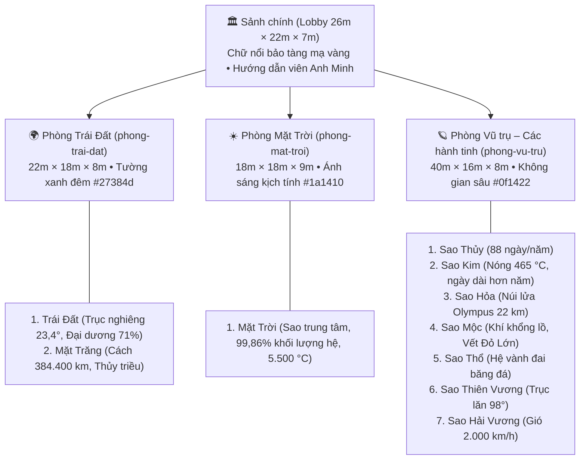

# Bảo tàng Không gian 3D – Hệ Mặt Trời
> Dự án Website bảo tàng 3D số hóa kiến trúc nhiều phòng, tích hợp hướng dẫn viên 3D thông minh đồng hành kể chuyện và trả lời câu hỏi.

---

## 1. Giới thiệu tổng quan

**Bảo tàng Không gian 3D** là một không gian trải nghiệm tương tác trực quan chạy hoàn toàn trên trình duyệt (máy tính và điện thoại thông minh). Khách tham quan sẽ bước vào sảnh chính trang trọng và lần lượt khám phá các phòng trưng bày thiên văn học: từ Trái Đất thân thuộc, đến Mặt Trời rực rỡ và hành trình ra tận rìa ngoài cùng của Hệ Mặt Trời.

### Thông tin chung:
- **Tên bảo tàng:** Bảo tàng Không gian 3D
- **Hướng dẫn viên 3D đồng hành:** Anh Minh
- **Đối tượng khách tham quan:** Học sinh, sinh viên, người yêu khoa học thiên văn và công chúng đại chúng.
- **Công nghệ nền tảng:** Vite + TypeScript (Strict Mode), Three.js (WebGL, Tone Mapping ACES, Shadow Map), HTML5/CSS3 thuần cho giao diện lớp phủ HUD.

---

## 2. Đặc tả dữ liệu Bảo tàng (`public/data/museum.json`)

Toàn bộ nội dung bảo tàng (tên phòng, kích thước, màu tường, vật liệu sàn, ánh sáng, danh sách thiên thể, thông số khoa học, câu chuyện kể và bộ câu đố) đều được tách biệt hoàn toàn vào tệp `public/data/museum.json`. Hệ thống được xây dựng theo kiến trúc **Data-Driven 3D** – thêm phòng hoặc thay đổi hiện vật chỉ cần sửa tệp JSON mà không cần viết lại mã nguồn.

> [!NOTE]
> **Lưu ý số liệu khoa học (`dataNote`):** Các thông số (đường kính, chu kỳ quay, khoảng cách, nhiệt độ) trong `museum.json` là giá trị trung bình đã làm tròn nhằm phục vụ mục đích giáo dục trực quan đại chúng. Kích thước hiển thị 3D được điều chỉnh tương đối để đảm bảo trải nghiệm quan sát tốt nhất trong không gian phòng trưng bày.

---

## 3. Bản đồ & Chi tiết các phòng trưng bày



### Chi tiết các phòng:

### 1. Phòng Trái Đất (`phong-trai-dat`)
- **Chủ đề:** Hành tinh của chúng ta và vệ tinh của nó.
- **Không gian:** Kích thước 22m × 18m × 8m, tường xanh đêm `#27384d`, sàn đá, ánh sáng dịu mát (cool).
- **Hiện vật trưng bày:**
  1. `hv-trai-dat` (**Trái Đất**): Mô hình quả địa cầu nghiêng 23,4°, có tầng khí quyển và mây chuyển động, chu kỳ quỹ đạo 365,25 ngày.
  2. `hv-mat-trang` (**Mặt Trăng**): Vệ tinh tự nhiên duy nhất, giải thích hiện tượng thủy triều và chu kỳ 27,3 ngày.
- **Bộ câu đố:** 3 câu trắc nghiệm về độ nghiêng trục Trái Đất, tỷ lệ đại dương và nguyên nhân thủy triều.

### 2. Phòng Mặt Trời (`phong-mat-troi`)
- **Chủ đề:** Ngôi sao ở trung tâm Hệ Mặt Trời.
- **Không gian:** Kích thước 18m × 18m × 9m, tường tối `#1a1410`, ánh sáng kịch tính (dramatic) phát tỏa trực tiếp từ khối cầu trung tâm.
- **Hiện vật trưng bày:**
  1. `hv-mat-troi` (**Mặt Trời**): Quả cầu khí nóng sáng đường kính tương đương 1,39 triệu km, nhiệt độ bề mặt ~5.500 °C, chiếm 99,86% khối lượng Hệ Mặt Trời.
- **Bộ câu đố:** 3 câu trắc nghiệm về phân loại sao, tỷ lệ khối lượng và nhiệt độ bề mặt.

### 3. Phòng Vũ trụ – Các hành tinh (`phong-vu-tru`)
- **Chủ đề:** Bảy hành tinh còn lại của Hệ Mặt Trời, xếp theo thứ tự khoảng cách từ gần đến xa Mặt Trời.
- **Không gian:** Hành lang thiên văn dài 40m × 16m × 8m, tường tối `#0f1422`, sàn đá hoa cương, ánh sáng kịch tính tập trung lên từng bệ hành tinh.
- **Hiện vật trưng bày (7 hành tinh):**
  1. `hv-sao-thuy` (**Sao Thủy**): Hành tinh nhỏ nhất, không có khí quyển, 1 năm chỉ dài 88 ngày.
  2. `hv-sao-kim` (**Sao Kim**): Hành tinh nóng nhất (465 °C), tự quay ngược chiều rất chậm (ngày dài hơn năm).
  3. `hv-sao-hoa` (**Sao Hỏa**): Hành tinh Đỏ với bụi oxit sắt, núi lửa Olympus Mons cao 22 km và 2 vệ tinh Phobos, Deimos.
  4. `hv-sao-moc` (**Sao Mộc**): Hành tinh khí khổng lồ lớn nhất Hệ Mặt Trời (139.820 km), cơn bão Vết Đỏ Lớn.
  5. `hv-sao-tho` (**Sao Thổ**): Nổi bật với hệ vành đai vô số mảnh băng đá, khối lượng riêng nhẹ hơn nước.
  6. `hv-sao-thien-vuong` (**Sao Thiên Vương**): Hành tinh băng khổng lồ có trục quay nghiêng 98°, nằm lăn trên quỹ đạo.
  7. `hv-sao-hai-vuong` (**Sao Hải Vương**): Hành tinh xa nhất, màu xanh thẫm của khí mê-tan, gió bão tới 2.000 km/h.
- **Bộ câu đố:** 5 câu trắc nghiệm chuyên sâu về đặc điểm kỳ thú của các hành tinh.

---

## 4. Hướng dẫn điều khiển và Trải nghiệm

| Nền tảng | Thao tác | Chức năng |
| --- | --- | --- |
| **Máy tính (PC)** | Phím <kbd>W</kbd>, <kbd>A</kbd>, <kbd>S</kbd>, <kbd>D</kbd> hoặc Mũi tên | Di chuyển tiến, lùi, sang trái, sang phải |
| | Giữ phím <kbd>Shift</kbd> | Chạy nhanh (tốc độ từ 3.8 lên 7.0 m/s) |
| | Kéo chuột / Click màn hình | Xoay hướng nhìn (khóa chuột Pointer Lock) |
| | Phím <kbd>H</kbd> hoặc Nút Hướng dẫn | Mở lại bảng hướng dẫn điều khiển |
| | Phím <kbd>Esc</kbd> | Nhả con trỏ chuột / Tạm dừng |
| **Điện thoại (Mobile)** | Cần điều khiển ảo (Virtual Joystick) góc trái dưới | Di chuyển đa hướng mượt mà |
| | Vuốt nửa phải màn hình | Xoay chuyển góc nhìn |

---

## 5. Hướng dẫn cài đặt và Khởi chạy

```bash
# 1. Cài đặt các gói phụ thuộc
npm install

# 2. Khởi chạy máy chủ phát triển cục bộ
npm run dev
# Mở trình duyệt tại: http://localhost:3000

# 3. Đóng gói kiểm tra sản phẩm
npm run build
```
